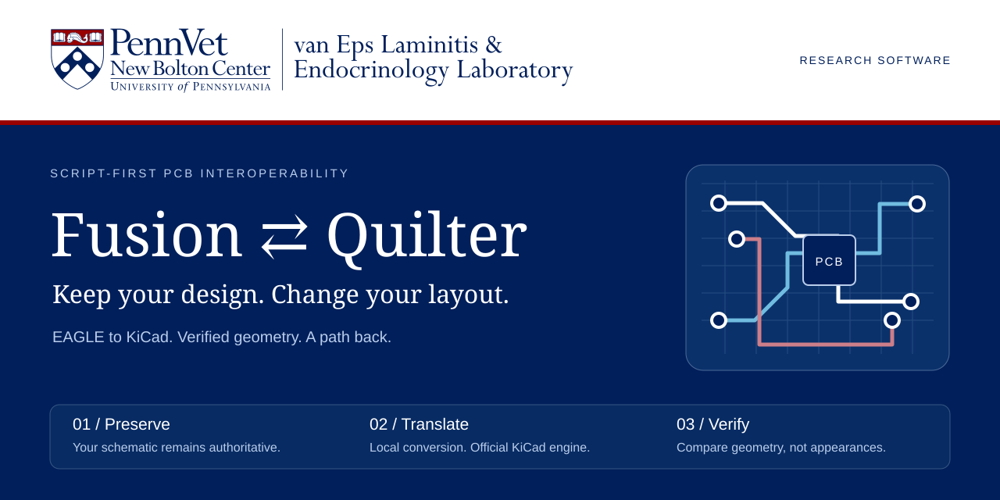
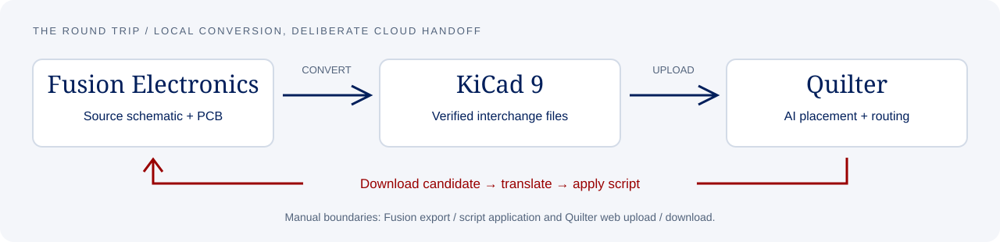

<p align="center">
  
</p>

<p align="center">
  <strong>Keep your design. Change your layout.</strong><br>
  A script-first bridge from Fusion Electronics to Quilter through KiCad — and back.
</p>

<p align="center">
  <a href="#quick-start">Quick start</a> ·
  <a href="docs/workflow.md">Workflow</a> ·
  <a href="docs/validation.md">Evidence</a> ·
  <a href="#limits-not-fine-print">Limitations</a> ·
  <a href="NOTICE.md">Licensing</a>
</p>

---

## A bridge, not a replacement

Your schematic remains the source of truth. Export EAGLE 9.x from Fusion, build
a KiCad 9 project for Quilter, then translate placement and copper back into an
EAGLE script or patched board. The script is intended to update the **existing**
Fusion PCB rather than create a disconnected copy.

The conversion runs locally with **KiCad's official engine and Python's standard
library**. No CAD window automation, cloud converter, pip dependencies or telemetry
is involved. Uploading a board to Quilter is a separate, deliberate step.

| Principle | What it means |
| :--- | :--- |
| **Preserve the source** | Original schematic, embedded libraries and connectivity remain authoritative. |
| **Verify the translation** | Compare net membership, pad geometry and copper, not just whether a file opens. |
| **Make limits visible** | Known format mismatches are reported; checks are not a manufacturing sign-off. |
| **Reproduce the evidence** | An original synthetic fixture exercises the real forward and return tools. |



## Quick start

### 1 · Install the engine

**Windows is the validated platform.**

| Dependency | Purpose |
| :--- | :--- |
| [KiCad 9](https://www.kicad.org/download/windows/) | Required for forward conversion: bundled Python, `pcbnew` and `kicad-cli`. |
| KiCad 10, side by side | Independent EAGLE board import check. Required for the complete round-trip self-test. |
| Fusion Electronics | Export the original design and apply the returned script. |
| [Quilter](https://app.quilter.ai) | Actual AI placement/routing, through its web interface. |

The Windows launchers locate standard per-user and system KiCad installations.
No `pip install` is needed. Pure-Python utilities are also tested with Python 3.11.
EAGLE footprint copper polygons that contain exactly one simple SMD pad are
converted to KiCad custom-pad primitives, preserving the original copper union
and pin number. Ambiguous ownership is an error, not a guessed net assignment.
The verifier checks the copper union independently against the original EAGLE
footprint, and copper shorts now fail forward verification rather than being
waived as ordinary pre-routing errors. Unrouted connections are still expected.
Do **not** replace KiCad 9's Python with KiCad 10's `pcbnew`; the latter has caused
initialization dialogs in headless use.

### 2 · Try the public demo first

From the repository root:

```powershell
.\Fusion_to_Quilter.cmd --input examples\roundtrip-demo
.\Selftest_Roundtrip.cmd --name roundtrip-demo
```

The [demonstrator](examples/roundtrip-demo) has **12 parts, 24 pads, four nets and
an 80 × 60 mm outline**. It exercises SMD and through-hole packages, restriction
wires, smashed text, rotations, flips, copper arcs, vias and pours.

> **Synthetic test geometry, not a working circuit.** The self-test simulates
> router edits; it is not Quilter AI and intentionally need not pass electrical DRC.
> No actual Quilter job or execution inside Fusion is claimed by these tests.

### 3 · Convert your own design

1. Create an `input` folder. Export the schematic and PCB from Fusion as EAGLE
   9.x files with matching names, such as `my-board.sch` and `my-board.brd`.
2. In Fusion, finalize the board outline and pre-place parts whose positions must
   remain fixed. Quilter's treatment of in-outline parts should be confirmed in
   its preview.
3. Run:

   ```powershell
   .\Fusion_to_Quilter.cmd --name my-board
   ```

4. Review the checks. Upload the **individual** `.kicad_pcb`, `.kicad_sch` and
   `.kicad_pro` files from `to_quilter\my-board\upload` to Quilter. Do not ZIP these
   upload files. Multi-sheet schematics produce additional schematic files;
   upload all files in the generated upload folder.
5. Download the selected candidate into a `from_quilter` folder, then run:

   ```powershell
   .\Quilter_to_Fusion.cmd --name my-board
   ```

6. Back up the original Fusion design. Open the **same PCB that was exported**,
   run the printed `SCRIPT` command, then inspect the result and run RATSNEST/DRC.

See the [full workflow](docs/workflow.md) for file selection, snapshots, automation
boundaries and return-path details. GUI export/import and web uploads still require
interaction. An optional loopback receiver supports browser-agent downloads without
the Save dialog; this project does not submit jobs or bypass account restrictions.

## What is checked

| Layer of evidence | Scope |
| :--- | :--- |
| Source comparison | Net names/members, part inventory, pad connectivity, copper and package keep-outs. |
| KiCad CLI | Exported schematic netlist, schematic/PCB parity and board outline. |
| Independent importer | KiCad 10 reads the EAGLE board and compares geometry with the converted/result PCB. |
| Round-trip self-test | Identity, simulated full layout, then a routed second pass. |
| Script model | Interprets the generated EAGLE commands and compares with the patched board. |

The public demo passed all three round-trip scenarios on Windows with KiCad
9.0.8 and 10.0.7. [Recorded scope and reproduction commands →](docs/validation.md)

The GitHub workflow runs **Python-only regression checks**, not the KiCad
integration suite. A green CI badge must not be interpreted as board certification.

## Limits, not fine print

This is **research software**, not a universal lossless converter.

* Return translation covers part placement, tracks, arcs, vias and supported copper
  pours. The original outline, drawing content and libraries are retained rather
  than replaced from the router's file.
* Known unsupported cases include router-created rule areas, teardrops and holes
  within pours. Some pour semantics differ between formats. Read every warning.
* Connectivity changes are not applied to the Fusion schematic. A router result
  that differs in connectivity must be investigated, not accepted as a new design.
* Locked parts, free holes and vias below Fusion restring limits have special
  behavior; see [return limitations](docs/workflow.md#return-limitations).
* The EAGLE-script interpreter is a **test model**, not Autodesk Fusion. It cannot
  prove live editor selection behavior, 3D linkage, cloud history or every script
  interaction. Validate on a backup before adopting the result.
* Conversion checks do not certify clearance, impedance, current capacity,
  component placement, thermal performance or manufacturability.

## Contribute without leaking a design

Start with the [synthetic example](examples/roundtrip-demo), read
[CONTRIBUTING.md](CONTRIBUTING.md), and submit a minimal reproducer.
User inputs, generated output, logs and local configuration are ignored.
An [explicit release inventory](tools/check_release.py) controls package contents.
Never attach proprietary schematics, libraries or raw logs to a public issue.

## License & acknowledgement

Original code, documentation and synthetic examples: **[MIT](LICENSE)**.
Lab/Penn branding is **excluded** from that license. KiCad is installed separately
and retains its own license. This is an independent interoperability project;
no endorsement by Penn, Autodesk, KiCad or Quilter is implied.

[Provenance and release authority](NOTICE.md) ·
[Maintainer publishing checklist](docs/publishing.md) ·
[Standalone presentation](docs/index.html)
